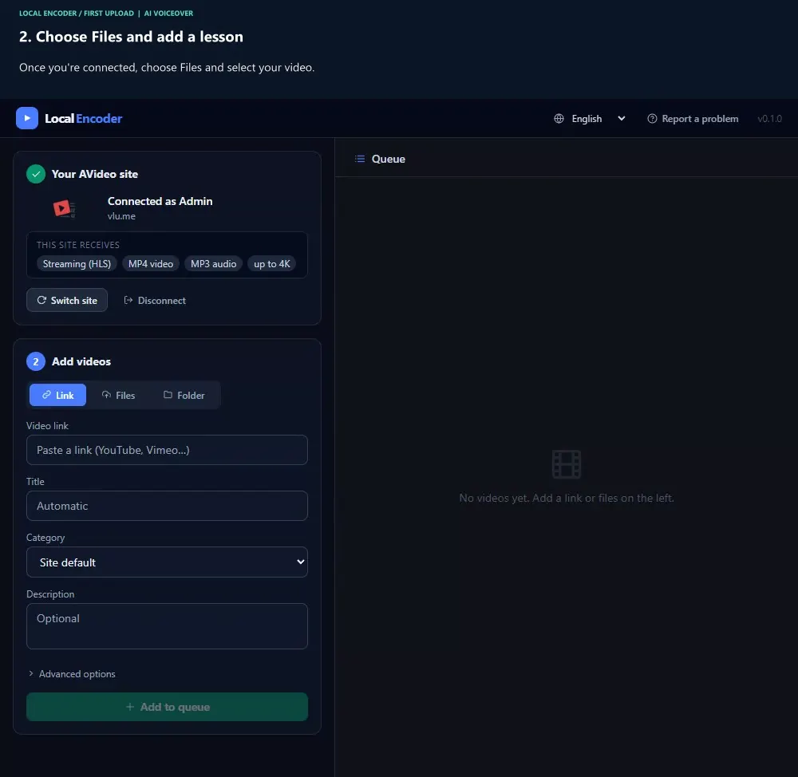

# User guide

[Download Local Encoder](../README.md#download) · [Report a problem](https://github.com/YPT-ME/Local-Encoder/issues)

## Download and open

Choose a download from the README, extract the **whole archive** and keep its files together.

| Computer | Choose | Open |
| --- | --- | --- |
| Windows 10/11 | Windows | Double-click **LocalEncoder.exe** |
| Mac with an Apple M-series chip | Apple Silicon | Double-click **LocalEncoder** |
| Mac with an Intel processor | Intel | Double-click **LocalEncoder** |
| Linux | x64 for Intel/AMD; ARM64 for ARM | Run `./LocalEncoder` in the extracted folder |

On a Mac, **Apple menu → About This Mac** shows the chip or processor.
GitHub's **Code** button and **Source code** archives are for developers.

The browser opens the control page. If it does not, try `http://127.0.0.1:47800`
or open the program again.

### First start warning

The app is not digitally signed yet:

- **Windows:** “Windows protected your PC” → **More info → Run anyway**.
- **macOS:** try opening it, then **System Settings → Privacy & Security → Open Anyway**.

## Connect and send

**[Watch the complete first-upload video](media/first-upload.mp4)** — English AI narration and
visible step captions. [Download the separate captions](media/first-upload.en.vtt).
The video shows real screens and a completed upload on a local test site. Password entry is
omitted, and chapter changes mark the cuts. File selection is slowed slightly for readability;
processing is shown in real time. The final chapter uses AVideo's embedded player.
Use the steps below if you prefer to read.

### 1. Connect to the right site

In **Your AVideo site**, enter the address you use to visit your video website, for example
`https://videos.example.com`. Use your normal site user name and password, then click **Connect**.
Your account needs upload permission; it does not need to be an administrator.

Wait for **Connected as …** and check the site name and account. The formats and qualities under
**THIS SITE RECEIVES** describe what that site accepts. They do not mean a small video will gain
detail by being converted to a higher resolution.

The local control page, usually `http://127.0.0.1:47800`, runs on **your computer**. Do not enter
that address as your AVideo site or as your site's **Encoder URL**.

### Choose Files, Folder or Link

| What you have | Choose | What to do |
| --- | --- | --- |
| One or more videos on your computer | **Files** | Click the drop area to select files, or drag videos onto it. Check the file list before adding them. |
| A folder of videos on your computer | **Folder** | Browse to the folder, click **Use this folder**, then select the videos to send. **Not sent yet** uses this computer's send history for the current site. Files are read in place; keep the folder available. |
| One video on a supported website, or a direct video URL | **Link** | Paste the individual video URL, wait for its preview and check that it is the right video. Private, removed or restricted sources may fail. Only import content you are allowed to publish. |

**Link** currently accepts individual videos, not whole playlists or channels.
If the source is already a file on this computer, use **Files** rather than typing its disk path
into **Link**. Selecting a source does not send it yet.

### 2. Add the details and start

For one video, replace **Automatic** with a useful title such as **Publish Your First Lesson**,
or leave it automatic to use the source title or file name. Multiple files and folder selections
use their file names. Optionally choose a category and add a description.

Leave **Advanced options** at their defaults for your first upload. Local Encoder chooses
compatible settings and uses hardware acceleration when available, with processor fallback.
Click **Add to queue** once you have checked the site and selected sources.

### 3. Recognize a successful upload

Follow the job through **Download → Convert → Send**. Files already on your computer do not
need an online download. The time depends on the source, chosen qualities, hardware and upload speed.

**Wait for Sent and The video is on your site.** A sending bar at 99% still needs the site's
confirmation. Keep the app and computer running; do not add a second copy just because this step
takes longer.

| When the job says Sent | Use it to… |
| --- | --- |
| **Open video** | Play the result on your AVideo site and check that it is the right lesson. |
| **Edit on site** | Review the title, description, poster and viewing access before sharing. Available choices depend on your site's settings and your permissions. |
| **Copy link** | Copy the video's address after checking that the intended viewers can access it. |

Completion confirms the site's receipt, not that the video has the privacy or payment rules
you intended. Review those on AVideo before distributing the link.

Choose English, Portuguese or Spanish at the top. The app remembers your sites and preferences
on this computer, **never your password**.

## While videos are processing

Keep the computer on. The app prevents sleep while working.
Closing the browser page keeps active jobs running; quitting the app stops them.
The queue survives page reloads, **not an app restart**.

Reopen the page from the icon near the Windows clock, the macOS menu bar, or by opening the
program again. To quit, use **Stop Local Encoder** or the icon's **Quit** menu.
Closing the last page when idle also stops the app.

## Troubleshooting

| Problem | Next step |
| --- | --- |
| The browser control page does not open | Make sure Local Encoder is running. Open it again or use its tray/menu-bar icon. The local address is not your AVideo website. |
| Cannot connect, or uploads are not allowed | Check the AVideo site address and your normal site login. Ask the site administrator to confirm upload permission. |
| A link does not produce a usable preview | Check that it is an individual, accessible video and that you can publish it. Update Local Encoder if the source site has changed. Whole playlist/channel links are not supported. |
| Sending stays near 100% | Wait for **Sent** and the site's confirmation. Do not start a duplicate upload. If the job reports a failure, use **Try again**. |
| Download, conversion or upload failed | Use **Try again**. Keep the original site and account connected; converted files are reused if the site's format and quality settings still match. |
| Need the converted files | Click **Open folder** on the job. |
| Some files could not be added | They stay selected so you can try again. |
| Need support | Click **Report a problem** and attach the generated log file to a [GitHub issue](https://github.com/YPT-ME/Local-Encoder/issues). Passwords are excluded. |

A job completes only after the site confirms it. Failed uploads keep their converted files.

## Open from your AVideo site

Open the downloaded app once. On updated AVideo/Web Encoder sites, **Open Local Encoder**
can then launch it and connect your signed-in account. Review the site, account and video;
click **Add to queue** yourself.

A blocked browser check does not mean the app is missing. Use **Open Local Encoder** or
**Check again**, or open the program directly and sign in. After moving or updating it,
open the new copy once. [Technical details](browser-integration.md).

## Update

When **New version available** appears, download the new package. Let current jobs finish,
quit the old app, extract the new download and open it. Releases track yt-dlp updates.

## AVideo server requirement

Keep the site's **Encoder URL** pointing to a working Web Encoder. Local Encoder prepares
uploads; live previews, recordings and other server-side services still need it.
[Service list](encoder-parity.md#avideo-services-that-still-require-the-web-encoder).
